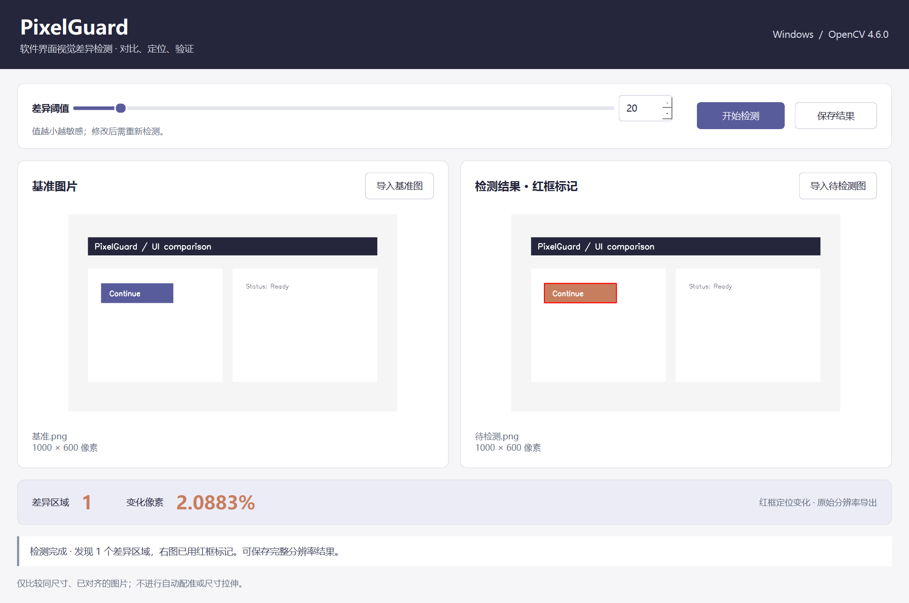
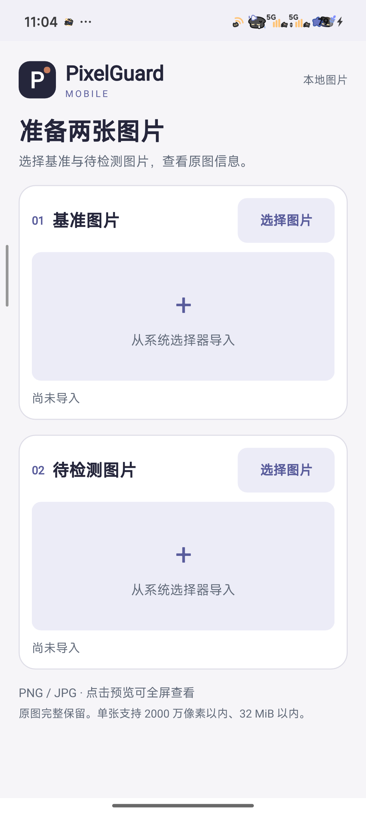
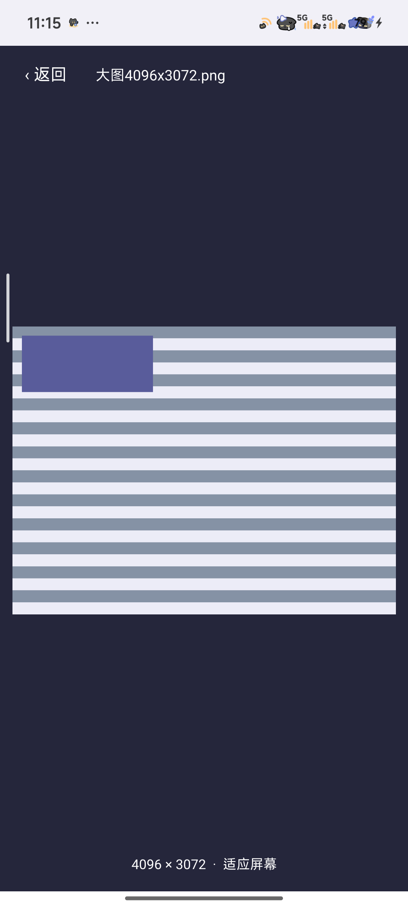

# PixelGuard

基于 **Qt Widgets + OpenCV** 的 Windows 界面视觉差异检测工具。导入同尺寸、已对齐的基准图与待检测图，定位可见变化，输出红框标注及有效变化像素比例。

适用于 UI 视觉回归辅助、界面版本比较、截图检查。它报告像素变化，**不会自动判断变化是否为 Bug**。



## 当前版本与功能

main 发布 Windows **v0.2.0 稳定版**：PNG/JPG 导入、左右等比例预览、0–255 阈值调整（默认20）、差异检测、红框标记、区域数量/变化百分比、完整原始分辨率 PNG/JPG 导出。支持中文路径、透明 PNG 白底合成，以及取消/读取失败/尺寸不一致等提示。

**main 不包含独立放大查看或原图/结果切换。** 这些功能保留在 `feature/ui-preview` 开发分支，未作为本次稳定版本发布。Android 为独立探索，本仓库不包含 Android APK 或验证工程。

## Android 移动端探索

PixelGuard Mobile **v0.1.0** 使用 Qt Quick/QML，在小米13（Android16、arm64-v8a）上完成图片导入与预览验证。下图为此前真机运行截图，已检查不含账号、姓名或私人图片内容；查看器中的条纹图为程序生成的测试图片。

<p align="center">
  
  
</p>

已验证：系统文件选择器与 `content://` 读取、PNG/JPG、中文文件名、原始尺寸保留、透明 PNG 白底、适应屏幕查看和返回。独立 Android OpenCV 验证工程也已执行与 Windows 一致的四组算法基线。

**正式移动应用目前仅接入导入和预览，尚未接入用户可操作的差异检测、统计、导出或分享。** Android 源码和 APK 仍在独立工程，本 Windows 仓库仅展示进展；以上截图不表示这些移动功能已经完成。

## 原理与架构

```text
absdiff → BGR2GRAY → threshold → 3×3 morphologyEx(MORPH_CLOSE)
        → findContours → 原始变化像素过滤 → 红框与统计
```

先求逐通道绝对差分，再灰度化，避免先灰度后比较导致部分颜色变化相互抵消。候选区域按原始阈值掩膜中的变化像素数过滤（默认最少8像素）。闭运算用于连接邻近变化，统计只计算保留的原始变化像素，不把形态学扩张面积算进去。

`变化比例 = 保留变化像素数 / 图像总像素数`。相同输入严格为0区域、0%。区域是轮廓连接块，不等于发生变化的控件数量。

- **DiffDetector**：仅依赖 OpenCV，接收 BGR 矩阵、返回矩形/掩膜/比例/标注图。
- **ImageIO**：QFile + imdecode 读取；QSaveFile + imencode 原子保存，处理中文路径和透明底。
- **Qt Widgets**：交互、阈值与结果状态、等比例预览；主题集中在 QSS。

```text
src/core/       核心算法
src/ui/         MainWindow、ImageIO、ImagePreview、Theme
resources/      QSS 主题
tests/          核心、读写、Widgets 与截图回归源码
test_images/    无个人信息的合成 UI 样例
docs/           构建说明与实际验证记录
```

## Windows 构建与运行

已验证环境：Windows11、VS2022 MSVC x64、Qt6.10.2 MSVC2022、OpenCV4.6.0 MSVC x64、C++17、CMake3.30.5、Ninja1.12.1。Qt/OpenCV 必须与编译器及架构兼容，不随源码附带依赖安装目录。

在 **x64 Native Tools Command Prompt for VS2022** 中执行，下列路径按本机安装位置替换：

```bat
cmake -S . -B build -G Ninja -DCMAKE_BUILD_TYPE=Release -DCMAKE_PREFIX_PATH="C:/Qt/6.10.2/msvc2022_64" -DOpenCV_DIR="C:/opencv/build/x64/vc16/lib"
cmake --build build
ctest --test-dir build --output-on-failure
```

Qt Creator 可直接打开 CMakeLists.txt，选择对应 MSVC x64 Kit，并配置以上两个依赖路径。运行开发版本前，在当前终端 PATH 中加入 Qt bin 和 OpenCV bin（不要求修改系统环境变量）。如 Ninja 的 showIncludes 前缀检测异常，参见 docs/BUILD.md。

生成便携目录时：先将 PixelGuard.exe 放入 dist，再对它运行同 Kit 的 windeployqt，复制匹配的 OpenCV Release DLL，并验证 VC Runtime。源码仓库不提交 dist 或第三方 DLL。本轮暂不发布新 Release 下载包。

## 使用教程

1. 导入基准图与待检测图（必须同尺寸且位置对齐）。
2. 调整阈值：低值更敏感，高值过滤更多弱变化。
3. 点击开始检测，查看右侧红框与统计。
4. 保存完整分辨率标注图。更换图片或调整阈值会清除旧结果。

## 测试

提供核心同图、颜色、位移、缺失、细笔画/噪点、阈值边界和非法参数测试；读写覆盖中文路径、PNG/JPG、透明底和导出重读；Widgets 回归覆盖导入、取消、检测、调参、失效及保存。公开截图回归改用合成 UI 数据，原课程账号截图不公开，也不沿用其原始测量数字。

本轮实际构建/测试结果、复现边界见 [验证记录](docs/VERIFICATION.md)。测试通过率不是算法准确率。

## 限制与后续计划

仅支持同尺寸、已对齐、8位 PNG/JPG；不做配准、OCR 或语义判断。阴影、抗锯齿和 JPEG 压缩也可能产生变化；弱于阈值或不足8像素的孤立变化可能被过滤，邻近文字可能被闭运算合并。大图压力与跨机器兼容性需要进一步验证。

后续：独立验证 UI 放大/结果切换分支、完善大图交互与跨机器发布验证；Android 继续在独立工程探索，不当作 Windows 已完成功能。

## 开发说明

项目曾使用 AI 辅助实现、测试与文档整理。功能与测试声明以实际代码和记录为依据，不虚构独立编码经历。当前未授予开源许可证；Private 仓库供个人整理，公开前需另行决定授权方式。
